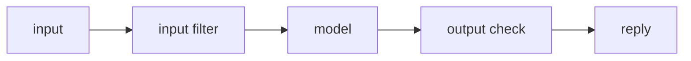

# Cognitive architecture

Purpose: how the AI thinks: flow, memory and retrieval, reasoning strategy, agents, failure handling.
Read this when: you change the AI pipeline.
Related files: docs/ai/TOOLS.md, docs/requirements/TECH-SPEC.md

Status: Draft

## Flow

## Memory and retrieval

{{RAG design or none}}

## Reasoning strategy

{{approach}}

## Agents

{{single agent | roles}}

## When it fails

- Malformed model output: {{retry policy}}
- Model unavailable: {{fallback}}
